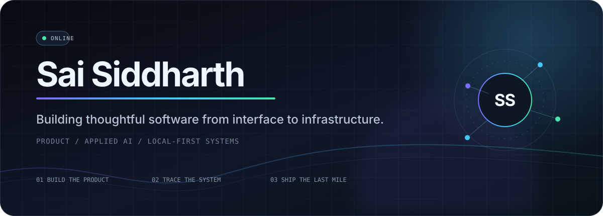
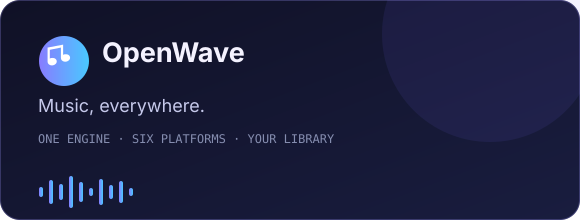
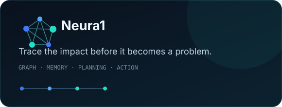
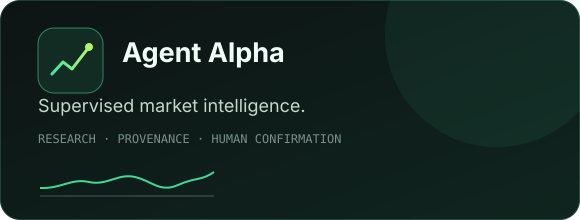
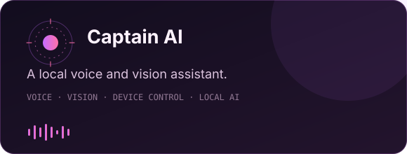
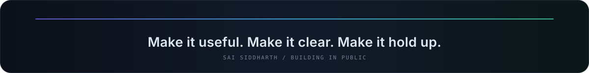

 

<a href="#selected-work"><b>Selected work</b></a>&nbsp;&nbsp;·&nbsp;&nbsp;
<a href="#what-i-work-with"><b>Technical scope</b></a>&nbsp;&nbsp;·&nbsp;&nbsp;
<a href="https://saisiddharthbs.github.io/OpenWave/"><b>OpenWave</b></a>&nbsp;&nbsp;·&nbsp;&nbsp;
<a href="https://github.com/SaiSiddharthBS?tab=repositories"><b>All repositories</b></a>

 

## About

I build software that turns complicated systems into products people can actually use. My work moves between **cross-platform applications, applied AI, financial tooling, and local-first infrastructure**—usually owning the full path from product design and interface work to backend services, data models, packaging, and release engineering.

Right now, I am focused on **OpenWave**, an open-source music player that runs across desktop, mobile, web, and home servers, and **Neura1**, a graph-based company brain for hardware manufacturers.

> I care about useful software, clear interfaces, private-by-default architecture, and engineering claims that can be inspected and verified.

## Selected work

<table>
  <tr>
    <td width="50%" valign="top">
      
        
      <b>OpenWave</b> 
      An open-source, non-commercial music player with one engine across macOS, Windows, Linux, Android, iPhone, and Docker. It includes a synced library, gapless playback, offline listening, and multi-device sessions.
        
      <code>Python</code> <code>FastAPI</code> <code>JavaScript</code> <code>SQLite</code> <code>Docker</code>
    </td>
    <td width="50%" valign="top">
      
        
      <b>Neura1</b> 
      A graph-based company brain that traces changes across parts, bills of materials, builds, customers, decisions, and owners—helping hardware teams understand impact before it reaches production.
        
      <code>Python</code> <code>FalkorDB</code> <code>Next.js</code> <code>MCP</code> <code>Local AI</code>
    </td>
  </tr>
  <tr>
    <td width="50%" valign="top">
       
      
        
      <b>Agent Alpha</b> 
      A supervised research and investing workspace for Indian markets, combining portfolio analysis, explicit data provenance, statistical workflows, and human-confirmed actions.
        
      <code>Python</code> <code>FastAPI</code> <code>React</code> <code>TypeScript</code> <code>Market Data</code>
    </td>
    <td width="50%" valign="top">
       
      
        
      <b>Captain AI</b> 
      A local voice assistant with wake-word detection, speech, screen understanding, device control, and a heads-up interface—designed to keep the core experience on the user's machine.
        
      <code>Python</code> <code>Ollama</code> <code>Whisper</code> <code>Piper</code> <code>Computer Vision</code>
    </td>
  </tr>
</table>

## What I work with

| Area | Tools and systems |
|---|---|
| **Product & interface** | TypeScript, JavaScript, React, Next.js, Flutter, responsive product design |
| **Backend & data** | Python, FastAPI, REST APIs, SQLite, graph databases, data pipelines |
| **Applied intelligence** | Local LLM inference, agents, MCP, speech-to-text, text-to-speech, computer vision |
| **Delivery** | Docker, GitHub Actions, cross-platform packaging, release automation, self-hosting |

## How I build

- **Start with the user journey.** Architecture earns its place by making the product clearer, faster, or more dependable.
- **Keep ownership close.** Local-first storage and self-hosting are useful defaults when privacy and control matter.
- **Show the evidence.** Provenance, tests, reproducible builds, and honest system states make complex tools trustworthy.
- **Finish the last mile.** Installers, documentation, screenshots, and upgrade paths are part of the product.

 

 

Open to thoughtful conversations about product engineering, applied AI, local-first software, and ambitious open-source tools. 
The best way to reach me is through an issue or discussion on the relevant repository.

