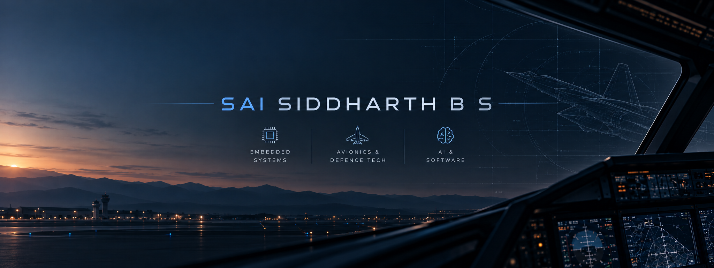
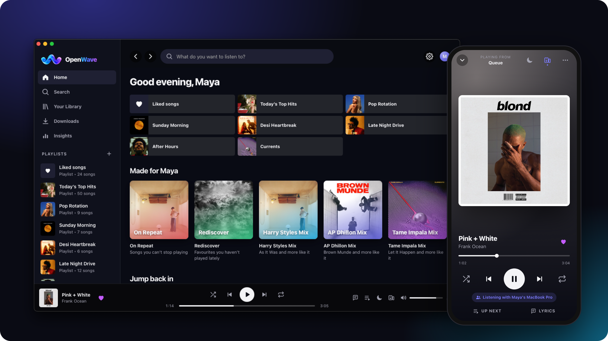
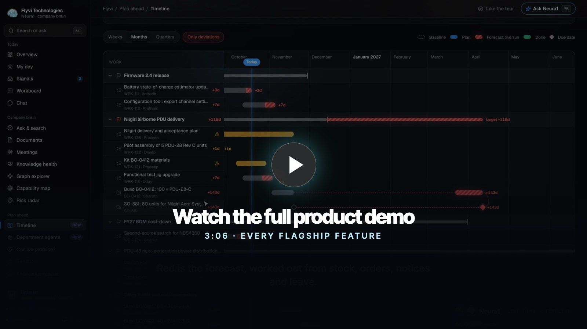

 

<a href="#selected-work">Selected work</a> &nbsp; / &nbsp;
<a href="#engineering-interests">Engineering interests</a> &nbsp; / &nbsp;
<a href="#toolbox">Toolbox</a> &nbsp; / &nbsp;
<a href="#connect">Connect</a>

<h1>Sai Siddharth B S</h1>

<b>Hardware curiosity. Software craft. Products that work.</b>

I build across applications, applied AI, and data systems. 
My interests extend into embedded systems, avionics, and defence technology.

 

## Selected work

Two projects that capture how I like to build: a complete everyday product and a system that makes complex relationships understandable.

### 01 / OpenWave

**One music library. Every device.**

An open-source music player with gapless playback, offline downloads, synced libraries, and shared listening sessions. A Python engine powers desktop apps, Android, an iPhone web app, and self-hosted deployments.

PYTHON &nbsp; / &nbsp; FASTAPI &nbsp; / &nbsp; JAVASCRIPT &nbsp; / &nbsp; SQLITE &nbsp; / &nbsp; DOCKER

**[Explore the code ↗](https://github.com/SaiSiddharthBS/OpenWave)** &nbsp; · &nbsp; [Visit the website](https://saisiddharthbs.github.io/OpenWave/) &nbsp; · &nbsp; [Download](https://github.com/SaiSiddharthBS/OpenWave/releases)

 

### 02 / Neura1

**Understand what a change touches.**

A company knowledge graph for hardware manufacturers. Neura1 connects parts, builds, customer orders, people, and past decisions to trace the consequences of a change. Graph queries, planning logic, and AI work together, with facts linked back to their sources.

PYTHON &nbsp; / &nbsp; FALKORDB &nbsp; / &nbsp; NEXT.JS &nbsp; / &nbsp; MCP &nbsp; / &nbsp; LOCAL INFERENCE

**[Explore the code ↗](https://github.com/SaiSiddharthBS/Neura1)** &nbsp; · &nbsp; [Watch the demos](https://github.com/SaiSiddharthBS/Neura1#readme) &nbsp; · &nbsp; [Read the evaluation](https://github.com/SaiSiddharthBS/Neura1/blob/main/docs/EVAL.md)

 

### Also on the workbench

**[Agent Alpha ↗](https://github.com/SaiSiddharthBS/Agent_Alpha)** &nbsp; QUANTITATIVE SYSTEMS 
Indian-market research and trading tooling combining machine-learning models, market-regime analysis, risk controls, and paper trading. 
Python · FastAPI · PostgreSQL · Ollama · Electron

**[Captain AI ↗](https://github.com/SaiSiddharthBS/Captain_AI)** &nbsp; VOICE & AUTOMATION 
A voice assistant with on-device speech processing, screen understanding, and device control, combining cloud language models with local vision. 
Python · Groq · Ollama · Faster-Whisper · Piper · OpenWakeWord

[Browse all repositories →](https://github.com/SaiSiddharthBS?tab=repositories)

 

## Engineering interests

**Embedded systems & avionics** 
The intersection of hardware, software, and dependable system behaviour.

**Applied AI & knowledge systems** 
Local inference, voice interfaces, graph-backed reasoning, and agents connected to useful tools.

**Product engineering** 
Taking an idea through interface design, backend services, packaging, documentation, and releases.

 

## Toolbox

**Applications** &nbsp; Python · TypeScript · JavaScript · React · Next.js · Flutter 
**Services & data** &nbsp; FastAPI · SQLite · PostgreSQL · FalkorDB 
**AI & integration** &nbsp; Ollama · vLLM · Whisper · MCP 
**Build & delivery** &nbsp; Git · GitHub Actions · Docker · Cross-platform packaging

<b>A few things I care about when building</b>

- Interfaces that make the next action obvious.
- Data ownership and practical self-hosting options.
- Traceable outputs and clear limits on what a system knows.
- Documentation and releases that make a project usable beyond my own machine.

 

## Connect

Interested in embedded systems, applied AI, or building useful open-source software? 
Start with an issue on the relevant project: **[OpenWave](https://github.com/SaiSiddharthBS/OpenWave/issues)** · **[Neura1](https://github.com/SaiSiddharthBS/Neura1/issues)**.

---

SAI SIDDHARTH B S &nbsp; / &nbsp; EXPLORING SYSTEMS. BUILDING PRODUCTS.

