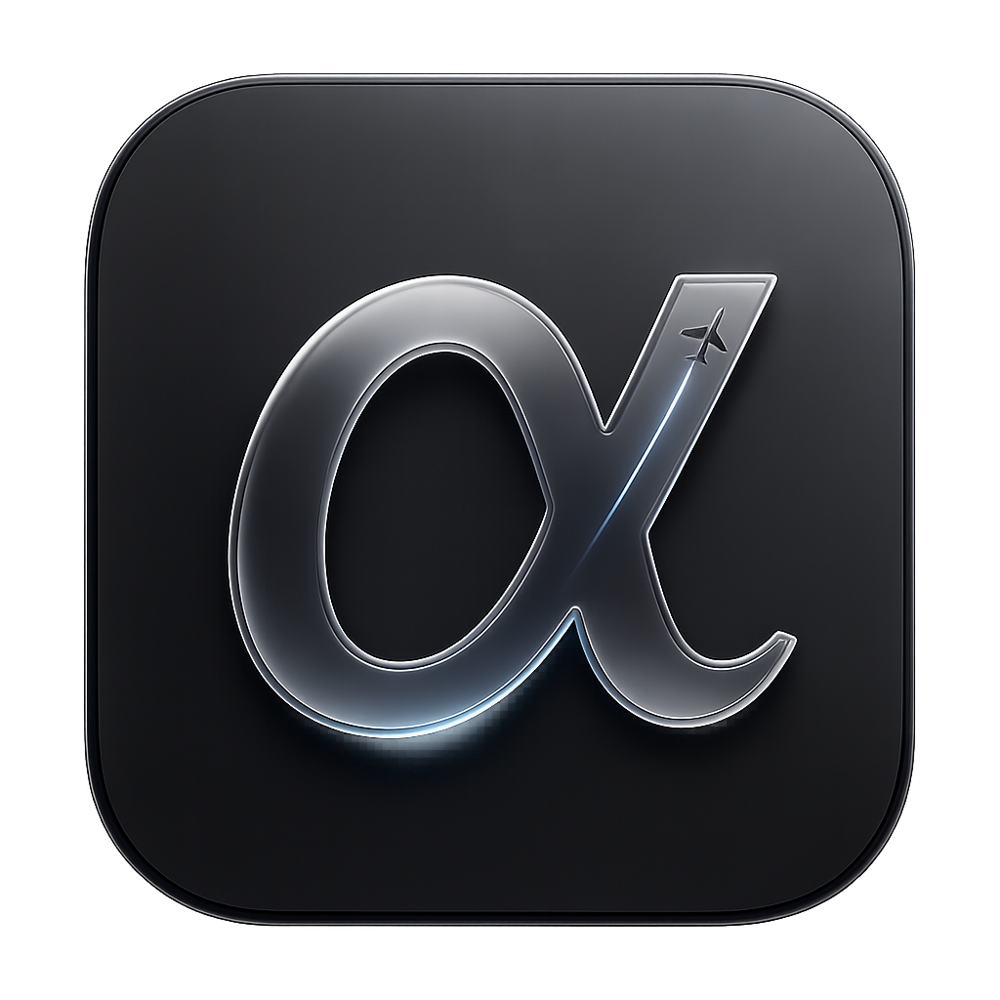
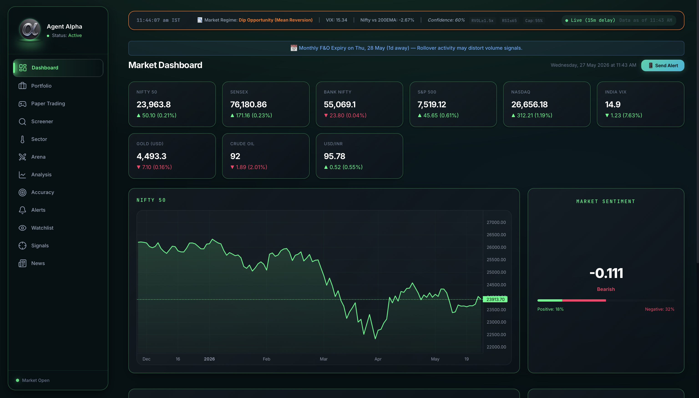
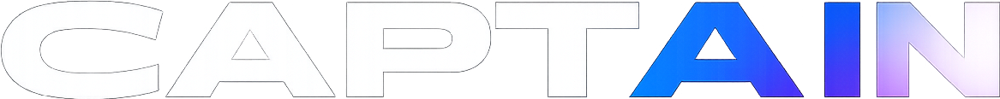
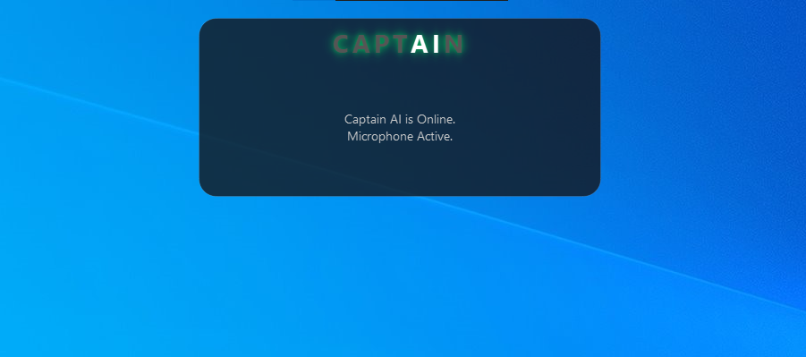

 

<a href="#selected-work">Selected work</a> &nbsp; / &nbsp;
<a href="#engineering-interests">Engineering interests</a> &nbsp; / &nbsp;
<a href="#toolbox">Toolbox</a> &nbsp; / &nbsp;
<a href="#connect">Connect</a>

<h2>Engineered with purpose. Built with intent.</h2>

 

## About

I'm an engineer and developer with a keen focus on embedded systems, avionics and artificial intelligence. My interests span firmware development and hardware integration to intelligent applications and comprehensive software solutions. I’m driven by a curiosity to understand complex systems, a passion for exploring emerging technologies, and the challenge of transforming ideas into robust, efficient, and meaningful solutions.

 

## Selected work

Four systems, four different problems: a company knowledge graph, a cross-device music player, a quantitative research engine, and a voice assistant.

[Neura1](#01--neura1) · [OpenWave](#02--openwave) · [Agent Alpha](#03--agent-alpha) · [Captain AI](#04--captain-ai)

### 01 / Neura1

<picture>
  <source media="(prefers-color-scheme: dark)" srcset="assets/neura1-logo-dark.png">
  <source media="(prefers-color-scheme: light)" srcset="assets/neura1-logo-light.png">
  
</picture>

**A company brain that shows what a change will affect.**

Neura1 connects a manufacturer's parts, builds, customer orders, people, and decisions in one knowledge graph. When something changes, it traces the impact, explains why, and helps the team plan what to do next.

**What the system brings together**

- **Knowledge with evidence.** Decisions, documents, conversations, and people are linked to the underlying work. An answer can lead back to the source that supports it.
- **Change impact.** A change to a part or supplier can be traced through product revisions, planned builds, customer orders, and the people responsible for them.
- **Planning before promises.** A timeline compares the original plan with the current forecast; stock, lead times, orders, and availability explain where a delivery may slip.
- **Action in existing workflows.** Department agents surface issues, while Zoho connections and MCP tools let Neura1 work alongside the systems a team already uses.

<b>Inside the engineering — graph, planning, and trustworthy AI</b>

#### One connected model

FalkorDB joins company records into a graph of parts, products, builds, suppliers, orders, customers, people, and decisions. Traversals reveal dependencies that would otherwise sit across separate spreadsheets and tools. Source links keep the reasoning inspectable.

#### Forecasts computed in code

The planning engine works from inventory, open purchase orders, supplier notices, lead times, and leave to forecast delays and explain their causes. A sandbox can test a proposed change on a copy of the graph before it affects the working plan. Cost and stock calculations stay in code rather than being guessed by a model.

#### AI with boundaries

The model helps find and summarize evidence, while validation checks quotes against sources and applies access rules to answers. A web interface, chat, document tools, and optional MCP connections expose the same underlying system to different teams. The repository includes a product demonstration and evaluation notes.

PYTHON &nbsp; / &nbsp; FALKORDB &nbsp; / &nbsp; NEXT.JS &nbsp; / &nbsp; MCP &nbsp; / &nbsp; LOCAL INFERENCE

**[Explore the code ↗](https://github.com/SaiSiddharthBS/Neura1)** &nbsp; · &nbsp; [Watch the demos](https://github.com/SaiSiddharthBS/Neura1#readme) &nbsp; · &nbsp; [Read the evaluation](https://github.com/SaiSiddharthBS/Neura1/blob/main/docs/EVAL.md)

 

### 02 / OpenWave

**One music library. Every device.**

OpenWave is an open-source music player designed to feel like one product across every screen. It brings gapless playback, offline downloads, synced libraries, and listen-together sessions to desktop, mobile, web, and self-hosted setups.

**What the system brings together**

- **One player across devices.** A shared Python engine powers macOS, Windows, Linux, and Android apps, an iPhone web app, and a Docker deployment.
- **The listening experience.** Gapless playback, synced lyrics, offline downloads, personal mixes, and playlist import turn a catalogue into a daily-use music library.
- **Your library, in your hands.** Profiles, playlists, likes, and history live in SQLite on your device or server, with changes synced across your devices.
- **Listening together.** Devices on the same network can discover and pair with one another, hand off playback, act as remotes, or join a synchronized session.

<b>Inside the engineering — playback, sync, and release delivery</b>

#### One engine, several native shells

FastAPI provides the catalogue, streaming, library, import, and device APIs. A shared web interface runs inside platform-specific shells, including Swift on macOS and Kotlin on Android. The same core behaviour reaches desktop, mobile, browser, and home-server use cases.

#### Playback and data ownership

The engine resolves audio tracks and proxies streams in chunks so playback can resume after an interrupted connection. Library operations are stored locally in SQLite; clients keep an outbox of changes made while offline and sync on reconnection. Nearby devices require pairing before they can control playback or join a session.

#### Shipping the whole product

The project includes installers, Docker images, checksums, in-app updates, screenshots, and setup guides. The release path matters as much as the player itself: someone should be able to install it and use it without reconstructing the development environment.

PYTHON &nbsp; / &nbsp; FASTAPI &nbsp; / &nbsp; JAVASCRIPT &nbsp; / &nbsp; SQLITE &nbsp; / &nbsp; DOCKER

**[Explore the code ↗](https://github.com/SaiSiddharthBS/OpenWave)** &nbsp; · &nbsp; [Visit the website](https://saisiddharthbs.github.io/OpenWave/) &nbsp; · &nbsp; [Download](https://github.com/SaiSiddharthBS/OpenWave/releases)

 

### 03 / Agent Alpha

**From market data to signals, risk decisions, and a paper-trading arena.**

Agent Alpha is my quantitative research and trading project for Indian equities. It brings market-data ingestion, technical analysis, machine-learning signals, market-regime classification, risk checks, and portfolio monitoring into a connected system. The engineering spans the analytical backend, scheduled jobs, persistent data, desktop interface, and remote monitoring.

**What the system brings together**

- **Multiple views of the market.** Technical indicators, momentum, machine-learning predictions, institutional flows, options data, and statistical-arbitrage research contribute to the analysis. Ensemble weighting combines signals into a directional assessment.
- **Market context and risk controls.** A four-state Hidden Markov Model classifies market conditions. A separate veto layer can override a signal, while volatility and Kelly-based sizing inform position allocation.
- **Research and simulated execution.** Screening, individual-stock analysis, portfolio views, and a paper-trading arena connect research with simulated positions and outcomes. Backtesting and signal-accuracy views support evaluation of the strategies.
- **An operational interface.** The dashboard is accompanied by an Electron desktop wrapper, a macOS menu-bar utility, and Telegram commands and alerts. These provide different ways to inspect the system and monitor its activity.

<b>Inside the engineering — models, infrastructure, and reliability</b>

#### Research pipeline

The documented model families cover trend and volatility indicators, momentum, boosted-tree classifiers, sequence models, institutional flows, and pairs research. The regime classifier adds context to those signals: an assessment in a quiet uptrend should be treated differently from one during a volatile drawdown. The risk layer then considers whether a candidate should proceed at all.

#### Compute and delivery

The deployment design separates a Mac-based interface and development workstation from an always-on Windows execution host. Docker services, scheduled scans, a FastAPI backend, PostgreSQL persistence, and Ollama-based language-model analysis support the system. SSH deployment tooling connects the development and execution environments.

#### Reliability work

The repository includes checks for database hangs, portfolio queries, pricing fallbacks, regime logic, statistical calculations, and the paper-trading engine. This matters because a research system depends on both its analytical logic and the quality and availability of the data feeding it.

PYTHON &nbsp; / &nbsp; FASTAPI &nbsp; / &nbsp; POSTGRESQL &nbsp; / &nbsp; OLLAMA &nbsp; / &nbsp; ELECTRON &nbsp; / &nbsp; DOCKER

**[Explore the code ↗](https://github.com/SaiSiddharthBS/Agent_Alpha)** &nbsp; · &nbsp; [Architecture & research](https://github.com/SaiSiddharthBS/Agent_Alpha#readme) &nbsp; · &nbsp; [Interface gallery](https://github.com/SaiSiddharthBS/Agent_Alpha#system-gallery)

 

### 04 / Captain AI

**A voice interface connected to the screen, the desktop, and the phone.**

Captain AI is my modular assistant project, built around a central intent router that coordinates speech, conversation, screen understanding, and device actions. It combines on-device audio processing with cloud language-model inference and local vision, bringing those capabilities into a desktop overlay and a remote Telegram interface.

**What the system brings together**

- **A complete voice loop.** OpenWakeWord detects the trigger, Faster-Whisper transcribes speech, and Piper generates spoken responses. Audio ducking lowers music during an interaction; cached speech output reduces repeated synthesis work.
- **Conversation with retrieved context.** Groq supplies streaming language-model responses, with Wikipedia and DuckDuckGo retrieval providing context for information requests. Ollama and Moondream handle local screen-image analysis.
- **Actions across devices.** Intent handlers connect voice commands to application launching, web navigation, email workflows, music, and Android automation through ADB. Persistent memory, to-do lists, alarms, and timers support everyday tasks.
- **A visible assistant state.** The Ghost HUD uses a frameless PyQt6 window and an HTML/CSS interface. WebSocket messages connect it to the backend, displaying listening, processing, and speaking states. A hotkey summons the overlay; Telegram provides another command channel.

<b>Inside the engineering — orchestration, audio, and the Ghost HUD</b>

#### One router, multiple engines

The central `Brain` routes input to independent speech, language, vision, and device-control engines. The architecture keeps microphone capture, model calls, audio playback, and interface updates as distinct responsibilities connected through the orchestration layer.

#### Voice pipeline and compute

The voice pipeline includes filters for spurious transcription, wake-word sensitivity, speech caching, and coordination between music and spoken output. Wake-word detection, speech recognition, speech synthesis, and the Moondream vision path run locally. The documented default conversational model uses Groq; retrieval and messaging integrations require network access. Android integration uses ADB commands and UI hierarchy parsing, and the repository demonstrates voice-driven email composition and phone workflows.

#### Interface evolution

The project progressed from a CustomTkinter prototype with logs and controls to the Ghost HUD: a compact overlay with a global shortcut and visual feedback for each interaction stage. A WebSocket protocol carries state changes between the Python backend and the interface. The repository includes screenshots of both generations and video demonstrations. Windows is the documented setup target; broader platform support remains development work.

PYTHON &nbsp; / &nbsp; PYQT6 &nbsp; / &nbsp; WEBSOCKETS &nbsp; / &nbsp; GROQ &nbsp; / &nbsp; OLLAMA &nbsp; / &nbsp; WHISPER &nbsp; / &nbsp; PIPER &nbsp; / &nbsp; ADB

**[Explore the code ↗](https://github.com/SaiSiddharthBS/Captain_AI)** &nbsp; · &nbsp; [Architecture & demonstrations](https://github.com/SaiSiddharthBS/Captain_AI#readme) &nbsp; · &nbsp; [Watch the Gmail workflow](https://github.com/SaiSiddharthBS/Captain_AI/raw/main/assets/demo_gmail.mp4)

 

[Browse all repositories →](https://github.com/SaiSiddharthBS?tab=repositories)

 

## Engineering interests

**Embedded systems & avionics** 
The intersection of hardware, software, and dependable system behaviour.

**Applied AI & knowledge systems** 
Local inference, voice interfaces, graph-backed reasoning, and agents connected to useful tools.

**Product engineering** 
Taking an idea through interface design, backend services, packaging, documentation, and releases.

 

## Toolbox

**Applications** &nbsp; Python · TypeScript · JavaScript · React · Next.js · Flutter 
**Services & data** &nbsp; FastAPI · SQLite · PostgreSQL · FalkorDB 
**AI & integration** &nbsp; Ollama · vLLM · Whisper · MCP 
**Build & delivery** &nbsp; Git · GitHub Actions · Docker · Cross-platform packaging

<b>A few things I care about when building</b>

- Interfaces that make the next action obvious.
- Data ownership and practical self-hosting options.
- Traceable outputs and clear limits on what a system knows.
- Documentation and releases that make a project usable beyond my own machine.

 

## Connect

Interested in embedded systems, applied AI, or building useful open-source software? 
Start with an issue on the relevant project: **[OpenWave](https://github.com/SaiSiddharthBS/OpenWave/issues)** · **[Neura1](https://github.com/SaiSiddharthBS/Neura1/issues)** · **[Agent Alpha](https://github.com/SaiSiddharthBS/Agent_Alpha/issues)** · **[Captain AI](https://github.com/SaiSiddharthBS/Captain_AI/issues)**.

---

SAI SIDDHARTH B S &nbsp; / &nbsp; EXPLORING SYSTEMS. BUILDING PRODUCTS.

